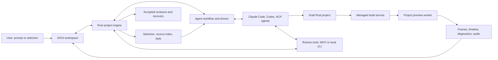

# fframes Studio

fframes Studio is a native GPUI app in Rust where a person describes a video, watches it, selects a scene or visible object, and asks a coding agent to change it. The agent edits an ordinary fframes Rust project. The app owns project setup, style presets, agent connections, compilation, preview, validation, history and export. Rust source remains the authority for the video; templates are starting points.

**Install the unsigned Windows preview** (per user, no administrator rights): `irm https://github.com/khanhthanhdev/fframes-desktop/releases/latest/download/install.ps1 | iex`, Scoop, or the Setup.exe from the [latest release](https://github.com/khanhthanhdev/fframes-desktop/releases/latest). The script first offers to install the only thing Studio does not bring, Visual Studio Build Tools with C++ and clang (through winget; that installer asks for administrator rights; `-Prerequisites Install` or `Skip` to not be asked). Rust, FFmpeg and fframes come with the managed SDK. winget follows once `khanhthanhdev.fframesStudio` is accepted into the community repository. See [preview releases](phase-zero-feasibility.md#unsigned-preview-releases).

Documents:

1. This README: setup and use, and which platforms are tested.
2. [Architecture](architecture.md): crates, engine flow, agent wires, preview pipeline, containment, tools, tests and probes, as built.
3. [Design system](design-system.md): the UI tokens, component kit and gallery every Studio screen is built from.
4. [Self-hosted runners](self-hosted-runners.md): which CI job runs which test, and how the runners are set up.
5. History, not the current design: [research findings](research.md), [implementation plan](implementation-plan.md), [feasibility record](phase-zero-feasibility.md).

## Setup

For a Windows-only preview release dry run, dispatch [Desktop Release](../../.github/workflows/desktop-release.yml) on the source branch with `preview_release=true`, `windows_only=true`, `dry_run=true` and `consumer_release=false`. Set `tag` to `v` plus the app version. It prepares the ZIP, installer, checksums and install manifests as the `studio-preview-dry-run` artifact and publishes nothing. Consumer publishing retains its separate signing and eligibility gates.

Run Studio from a checkout:

```sh
cargo run --locked --manifest-path desktop/Cargo.toml -p fframes-studio
```

The app is the `fframes-studio` package in [`desktop/app`](../../desktop/app). The package also builds the `studio-tools` CLI and the `studio-mcp` server that agents use; `studio_setup` ([`desktop/crates/studio-sdk/src/bin/studio_setup.rs`](../../desktop/crates/studio-sdk/src/bin/studio_setup.rs)) is the GPUI-free doctor and project scaffolder.

Projects compile against a managed SDK. The setup screen installs it step by step and marks the failing step if setup fails. The SDK manifest comes from the packaged bundle or `FFRAMES_SDK_BUNDLE`, then from the built-in manifest when it targets this host; development builds also look for a bundle assembled into the desktop workspace's target folder, `phase-zero-sdk` ([`build-phase-zero-sdk.ps1`](../../desktop/scripts/build-phase-zero-sdk.ps1) on Windows, [`build-phase-zero-sdk.sh`](../../desktop/scripts/build-phase-zero-sdk.sh) elsewhere); otherwise Studio uses the installed SDK's receipt (`~/.fframes/sdk/active`) or asks you to import a bundle ([`sdk_setup.rs`](../../desktop/crates/studio-engine/src/sdk_setup.rs)). Host prerequisites are checked against the selected SDK's manifest. Opening a project never installs an SDK or runs Cargo.

- **Where SDKs are found.** The SDK folder is `FFRAMES_SDK_HOME` when set, otherwise `.fframes/sdk` under `HOME` or `USERPROFILE`, whichever already holds an installed SDK. On Windows, libclang is found through `LIBCLANG_PATH`, `Program Files\LLVM`, a Scoop install or Visual Studio's bundled LLVM, and builds use the folder the doctor found.
- **Which SDK a project builds with.** A project builds with the installed SDK its `studio.json` is pinned to: the active one, or the one the last install replaced (`previous`), so installing a newer SDK keeps older projects building. **Select installed SDK…** still overrides this.
- **Projects whose SDK is missing.** When a project (often an imported one) is pinned to an SDK that is not installed, the Project tab says which SDK it needs. **Use installed SDK** rewrites the pin in `studio.json` to the active SDK; source that does not compile with that SDK's framework reports it at the next build.
- **SDK updates.** When the app ships a different SDK than the installed one, the SDK status says an update is available and **Install managed SDK** installs it.
- **App updates.** At launch Studio asks GitHub for the latest release ([`updates.rs`](../../desktop/crates/studio-engine/src/updates.rs), using the system `curl`) and shows a notice with **Download…** when it is newer. Nothing is downloaded or installed automatically. **Settings → General → Updates** turns the launch check off (`update_check_disabled` in `app-settings.json`) and has **Check now**.

App data lives in `%LOCALAPPDATA%/fframes-studio` on Windows, `~/Library/Application Support/fframes-studio` on macOS and `${XDG_DATA_HOME:-~/.local/share}/fframes-studio` on Linux ([`app_paths.rs`](../../desktop/crates/studio-engine/src/app_paths.rs)). It holds the SQLite metadata, per-project journals, checkpoint objects, the agent draft and stored agent sessions, build copies and `app-settings.json`. None of it travels with the project.

## Projects

**Create** chooses a new folder and writes the template ([`desktop/crates/studio-project/templates`](../../desktop/crates/studio-project/templates)): a Rust crate whose scenes carry an `editor_instance_key`, a `timeline.json` opt-in in `src/main.rs`, a Studio worker entry, style tokens and `AGENTS.md`. **Import Rust** selects a package's `Cargo.toml`, keeps existing files, instructions and Git history, and adds only `studio.json`. Managed builds support contained workspace dependencies; external paths, symlinks, inherited Cargo configuration and overrides produce diagnostics instead of hidden rewrites.

Source and copied assets travel with the folder; local history does not. A checkpoint saves bytes, not proof of a successful build. **Restore as copy** exports a checkpoint to a separately identified folder and never replaces the current source. **Locate** reconnects a moved, unchanged project; **Remove recent** removes only the list entry.

**Projects made by an older Studio are refused.** There is no migration. A `studio.json` of an earlier schema or instruction version is refused with "made by an older Studio … The project is left as it is and cannot be opened" ([`manifest.rs`](../../desktop/crates/studio-project/src/manifest.rs)), and the same rule covers the history database, journals, checkpoint inventories, stored agent sessions and the provider registry: an old file is reported and left byte for byte, and nothing repairs or rewrites it. A file from a newer Studio asks you to update Studio. An `agent-adapter.json` or a single-session conversation log from an earlier build is simply ignored, and Setup is shown again.

To open an existing fframes project, follow [Open an existing fframes project in Studio](open-fframes-project-in-studio.md).

### Try real repository examples

After installing the managed SDK in Setup, run this from the repository root (PowerShell):

```powershell
cargo run --locked --manifest-path desktop\Cargo.toml -p studio-engine --example prepare_examples -- --out "$HOME\fframes-studio-examples" --check
```

This creates independent, editable **Hello World**, **Motion Graphics**, **Signal Lab**
and **fframes Studio Intro** projects. In Studio choose **Open project**, select one of the generated folders,
then **Build preview**. Signal Lab has four scenes and a soundtrack for testing the
timeline and audio; the others cover basic rendering and animation.

To prepare only the full landscape Studio Intro video (including its shared soundtrack,
sound effects, clips and component fonts), use:

```powershell
cargo run --locked --manifest-path desktop\Cargo.toml -p studio-engine --example prepare_examples -- --example fframes-studio-intro --out "$HOME\fframes-studio-examples" --check
```

The intro bundles `fframes-components` 0.1.2 from the local Cargo source cache with its
license and credits. If it is not cached, run `cargo fetch --locked` from the repository
first. Its seven scenes remain editable. **Studio's CPU preview and export omit the
original Skia shader effects** (grain, contour and grid); the shader source is retained,
and the generated project's `PREVIEW-NOTES.md` records this limitation. The repository's
original Skia CLI is unchanged; the copy uses the generated CPU CLI/worker instead.

The command copies the actual example source and media, adds the Studio preview/export
worker and a CPU CLI, and pins each project to the installed SDK. `--check` builds and
exercises the same managed preview worker used by the app (timeline, frame and audio).
Omit it to only prepare the folders; `--sdk <installed-sdk-folder>` selects another SDK.
On Unix, use `/` in paths and an output such as `"$HOME/fframes-studio-examples"`.

Choose an output **outside the repository** so its inherited Cargo configuration and
workspace dependencies do not interfere. Existing copies are never overwritten, and the
original examples are unchanged. Edit the copied video under `examples/<name>/src` and
its embedded assets under `examples/<name>/media`. The intro also keeps the runtime
media in its original `examples/*/dynamic_media` folders. Other examples needing
external footage or extra dependencies are not yet adapted by this command.

## Editing

**Build preview** compiles the project in an isolated, SDK-bound copy and prepares the timeline, inspection, first frame and audio before replacing the displayed revision. Failed or cancelled builds keep the previous preview, and installing a preview never moves the saved checkpoint.

The player plays, pauses and steps frames; the ruler scrubs. Click a scene or use **Cycle scene** to select overlapping instances, and drag or Shift-drag on the tracks to select a half-open range. When the worker supports canvas selection, a click on the preview pauses and selects the object under the pointer, **C** cycles through overlapping objects, Ctrl-wheel zooms, middle-drag pans, **0** fits and Shift-drag selects a rectangle. Selections do not edit source; they scope the next agent task.

The timeline ([`studio-ui/src/timeline`](../../desktop/crates/studio-ui/src/timeline)) shows the scene clips in play order, the audio files and the mix waveform. **Split**, trim and move edit `timeline.json` directly, with undo and redo; a drag is one undo step and one write, and a timing-only change does not rebuild. Timing edits are refused while an agent task runs. See [architecture, timing](architecture.md#timing-document-and-revision).

The sidebar's **Props** tab ([`studio-ui/src/props_panel.rs`](../../desktop/crates/studio-ui/src/props_panel.rs)) edits the props of the component selected on the canvas when the project's worker supports props documents (`set_props_v1`, see [editable props](../components/components.md#editable-props-fframes-studio)). Each field gets a control for its kind: a text field, a slider for a bounded number, a colour with its swatch, a toggle or a row of choices, and the reset button returns a field to the code's value. The values go into `props.json` at the project root with undo and redo, and a slider drag is one undo step and one write. Like `timeline.json`, the file is left out of the build revision: a props edit re-renders the preview without rebuilding, and an export passes the document to the worker with `--props-file`. An export with edited props needs a worker that reports `props` in its export capabilities. If it does not, Studio refuses the export and says so. Props edits are refused while an agent task runs or while `props.json` is invalid. A change to the file outside Studio reloads it and clears the props undo history.

**Mute** silences output without stopping the clock. **Settings → General → Audio output** has **Next output**, **Retry audio** and **No audio**, which pick the output device or a silent clock. The device, its latency and underruns appear above the preview and on that page.

**Settings → Presets** applies a preset or edits token overrides through the same durable file-set transaction as an agent edit; the sidebar's **Style** tab lists the project's style files and opens that page. **Settings → SDK** installs, imports or selects the managed SDK. **Export…** opens a panel in place of the editor with the formats the project's worker can encode, the size and frame rate, an estimate of the file size, progress and **Cancel export**. The panel starts from the defaults saved in **Settings → Export** (format, size, frame rate); a default the project's SDK or video cannot take falls back to the built-in one, and a change in the panel applies to that export only.

## Agent panel

The agent panel is the **Agent** tab of the sidebar on the window's right, beside the player. The sidebar's other tabs are **Project**, **Assets** and **Style**. Drag the grip on the sidebar's left edge to widen or narrow it (320 to 520 px, not saved between launches). While another tab is open, a dot on the Agent tab means the agent is waiting for an answer, and a permission request switches back to the Agent tab. The panel has three tabs of its own: **Chat** (the conversation, the plan and the composer), **History** (stored sessions) and **Changes** (the review policy, chosen in **Settings → Agent → Review**, Apply, Undo, accepted edits and recovery). The settings button in the panel header opens the settings window on its **Agent** page.

### Providers and wires

Studio has three agent wires, and the **Protocol** control on the Agent page chooses one per saved adapter: Claude Code's native stream-json wire and Codex's native app-server wire, which start the `claude` or `codex` CLI you point the executable at, and the Agent Client Protocol (ACP v1) for every other agent. New Claude and Codex profiles use their native CLIs; Pi and Antigravity use ACP. Saved protocol choices are retained ([`provider_profiles.rs`](../../desktop/crates/studio-engine/src/providers/provider_profiles.rs)). The native wires refuse a CLI older than the minimum version in [`claude/launch.rs`](../../desktop/crates/studio-harness/src/driver/runtime/claude/launch.rs) and [`codex/launch.rs`](../../desktop/crates/studio-harness/src/driver/runtime/codex/launch.rs). See [architecture, agent wires](architecture.md#agent-wires).

- **Detect agents** lists installed agents by checking that files exist; it never starts them. Launching uses only the saved absolute path or the managed adapters folder, never a search of the global `PATH`.
- **Select** saves the adapter in `provider-registry.json` and runs one connection test. **Check adapter** tests again, for example after you sign in with the agent's own tool. **Install adapter** installs a pinned ACP adapter package from the lockfile Studio ships; **Install guide** opens the agent's official install page. Opening a project never launches an agent.
- For an ACP profile, when the agent's CLI is found but its ACP adapter is not, the Agent page says so and offers **Install adapter** (and **Get Node.js** when Node is missing); an install stops after 15 minutes ([`adapter_install.rs`](../../desktop/crates/studio-harness/src/adapter_install.rs)).
- Sign-in stays with each agent. The registry stores only the names of sign-in environment variables, never their values, and refuses a value pasted where a name belongs. `CLAUDECODE*` variables are never passed to an agent ([`discovery.rs`](../../desktop/crates/studio-harness/src/discovery.rs)).
- A turn stops after 15 minutes without agent activity or 2 hours in total ([`runtime/mod.rs`](../../desktop/crates/studio-harness/src/driver/runtime/mod.rs)). Every permission request becomes a card pinned above the prompt with the agent's choices, plus **Decline** when the agent offers no way to refuse; the transcript keeps a one-line record and, once answered, the choice. Studio answers a request itself only under the permission policy you chose (first-run setup, or **Settings → Agent → Permissions**; the agent header shows it):
  - **Ask every time** (the default for installs from before the setup existed): every request is a card.
  - **Allow in the working copy** (suggested by the setup): reads, searches, edits, deletes and moves whose every path is inside the task's working copy are allowed once; commands, network access, unknown tools and paths outside the working copy still ask.
  - **Allow everything**: every request is allowed once, commands included. They run on this computer, not in a sandbox.

  Studio always picks the agent's own `allow_once` option, never `allow_always`, never answers a question, and records each automatic answer in the transcript ("Allowed automatically · …"). A running task keeps the policy it started with ([`auto_answer.rs`](../../desktop/crates/studio-engine/src/agent/auto_answer.rs)).
- On first launch, when the SDK or an agent is still missing, Studio opens a setup in place of the workspace: Appearance, SDK, first video, Agent and Permissions. Every step can be skipped; **Settings → General → Run setup again** reopens it. The record lives in `app-settings.json` (`onboarding_completed`, `permission_policy`).
- The Agent page shows the writer containment the last launch verified (a job object on Windows, a process group with an escape scan on Linux and macOS). A writer that is not contained cannot have its candidate captured.

### The composer

The composer ([`studio-ui/src/agent/composer`](../../desktop/crates/studio-ui/src/agent/composer/mod.rs)) is a multi-line input with IME support. Enter sends, Shift+Enter breaks the line, Tab accepts a slash-command completion from the list the agent advertises, and Escape closes the completion. Paste or attach project files, files outside the project (after you confirm the exact path shown) and images; the engine checks every attachment before it shows a chip.

While a turn runs, Enter does what the agent supports: **Steer** hands the message to the running turn, **Send at boundary** holds it for the next step or turn, and Ctrl+Enter (Cmd+Enter on macOS) is **Send now**, which cancels the turn and sends. A brief that is not delivered to the running turn waits in the queue for the next task, eight at most, and starts from the then-current source. The agent's plan appears as a todo list above the composer, and its questions appear as cards that you answer item by item. **Stop** is available in every running state.

### Multi-session history

Each project keeps many agent sessions. **New chat** in the panel header starts a new one; the History tab lists every stored session with search, newest first, and **New session**. Opening a stored session shows its rows and resumes the agent's own session only when the project, its draft and revisions and the provider's launch still match; otherwise the panel says why it cannot resume. Attachment bytes are never stored.

### Review and diffs

A validated candidate is applied automatically under the default review policy, or waits for **Apply** under manual review. **Review changes** opens the review window in place of the preview: a file list with change counts beside unified or split diffs with syntax colours ([`studio-ui/src/agent/changes`](../../desktop/crates/studio-ui/src/agent/changes/mod.rs)). Before Apply you can turn files off; the remaining subset is validated again before it can be applied, and turning every file off asks first, then discards the candidate. After Apply, **Revert** on a file builds an undo candidate for that file alone, validated like an Apply; it is refused when the file changed since or was already reverted (`AgentWorkflow::revert_path` in [`agent.rs`](../../desktop/crates/studio-engine/src/agent.rs)). **Undo last agent edit** reverts one accepted revision, keeps unrelated edits and is validated like an Apply. Conflicts list every preserved variant.

Validation reports the rendered and inspected frames, boundary frames, audio checks, diagnostics and capability gaps. At most one automatic repair turn runs.

## Keyboard

All key bindings are installed in one place, `bind_keys` in [`shell/keymap.rs`](../../desktop/crates/studio-ui/src/shell/keymap.rs), which also binds the text input keys and the composer's keys ([`composer/keymap.rs`](../../desktop/crates/studio-ui/src/agent/composer/keymap.rs)). Key contexts go from most specific to least: a focused text field, the agent composer, then the player and the timeline, then the window. Plain keys are bound only in the player and the timeline, so typing in a field never reaches them.

| Context | Keys |
| --- | --- |
| Player | Space play/pause, Left/Right step, Home/End seek, C cycle canvas selection, 0 fit, Escape clear selection |
| Timeline | Space, Left/Right, Home/End as in the player; M mute; + / - zoom; PageUp/PageDown pan; S cycle scene; C split at the playhead; [ and ] mark the range; Ctrl+Z / Ctrl+Shift+Z undo and redo timing edits |
| Window, outside text fields | Ctrl+Z / Ctrl+Shift+Z undo and redo timing edits |
| Composer | Enter send, Shift+Enter new line, Tab accept completion, Ctrl+Enter send now; the usual editing keys |

On macOS the command key replaces Ctrl. Controls are tab stops and activate on Enter and Space; the Windows caption buttons are the exception ([design system](design-system.md#keyboard-and-focus)).

## Platforms

- **Windows** is the platform the hand checks are made on ([platform checks](../../plans/261013-0733-studio-m6-cleanup/reports/platform-checks.md) records them), and the full local test sets run there. A self-hosted Windows runner also runs the tests in CI.
- **Linux** compiles and runs the tests on the self-hosted CI runner, including the X11 shell test on Xvfb in full runs ([self-hosted runners](self-hosted-runners.md)).
- **macOS is not fully tested.** It is covered only by CI: the Desktop CI `desktop-macos` job runs the tests and clippy on hosted macOS for pull requests and manual runs ([`desktop.yml`](../../.github/workflows/desktop.yml)), and Desktop Release builds the macOS package. No hand check, real-CLI check or on-screen check runs on macOS ([roadmap, Platforms](../../plans/261013-0733-studio-rewrite-roadmap/plan.md#confirmed-contract)).

Agent tests use scripted peers or fake CLIs.

## Architecture at a glance



"Agent finished" and "video ready" are separate states: the app still builds, inspects and renders the result before it shows it as accepted.
