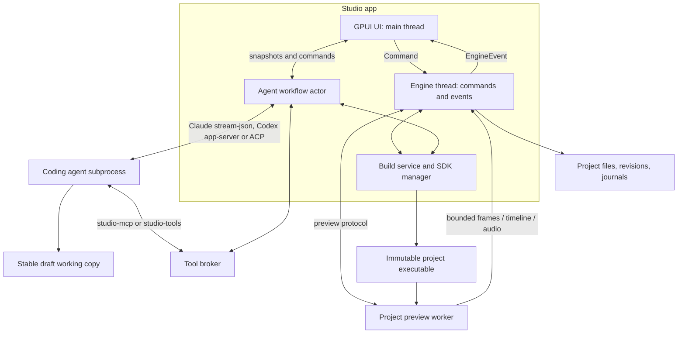
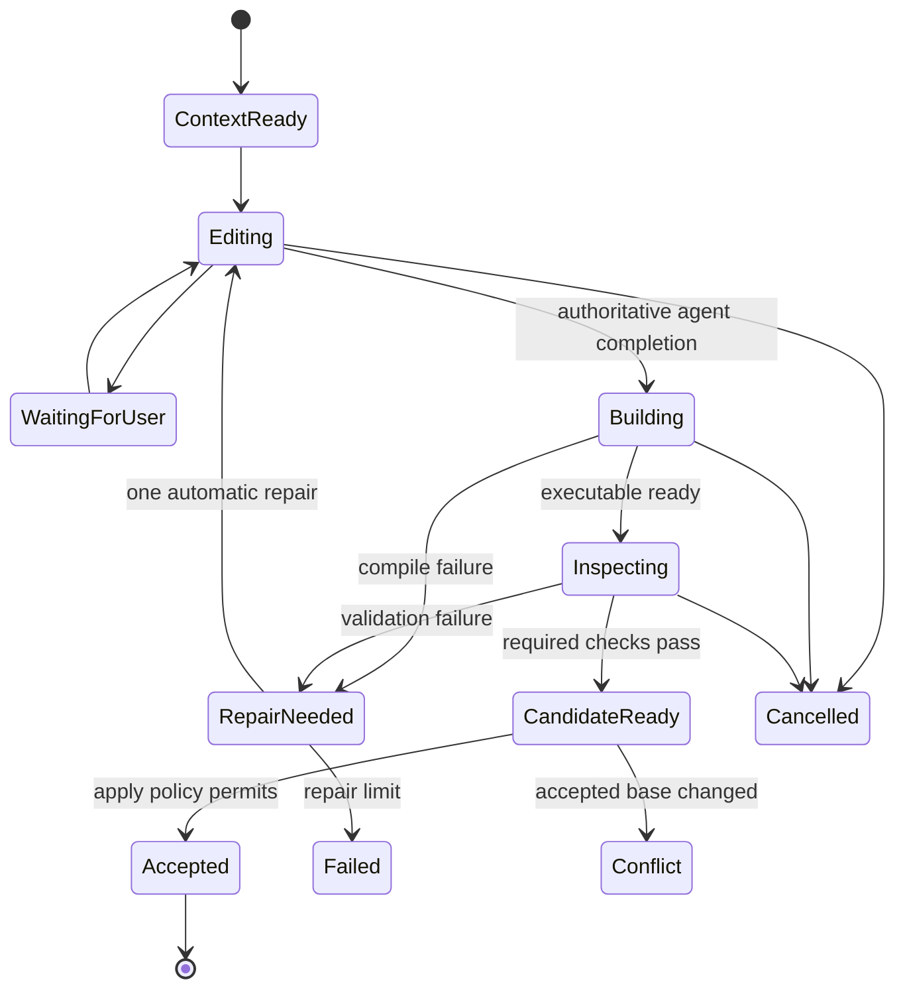

# Product and technical architecture

This document describes fframes Studio as it is built in [`desktop/`](../../desktop). It names the owning crate, module or test for each part instead of repeating its details; when this text and the source disagree, the source wins. How to run and use the app is in the [README](README.md). The [research findings](research.md), the [implementation plan](implementation-plan.md) and the [feasibility record](phase-zero-feasibility.md) are history.

## 1. The product contract

Studio is a visual workspace for making videos with coding agents. The default experience is an agent conversation, a preview and a timeline. A user can work without reading Rust; the resulting project remains understandable and editable as Rust.

The app owns the authoring loop:

**Brief or selection → grounded task → agent source edit → compile → inspect → preview → accepted revision → export.**

Templates seed source, assets and editor metadata. They do not restrict the user to a fixed set of template parameters. A review window shows the agent's changes as diffs when the user asks for it; it does not dominate the workspace.

### Main workspace

```text
┌ Project name · file, project and export actions ········ Settings ┐
│ Agent | Project | Assets | Style │            Player             │
│                                  │   preview, canvas selection   │
│ Agent: Chat | History | Project  │                               │
│ transcript, plan, composer       │ transport: play, frame, build │
├──────────────────────────────────┴───────────────────────────────┤
│ Timeline: ruler · scene clips · audio files · Mix · minimap      │
└──────────────────────────────────────────────────────────────────┘
```

The layout ([`shell/layout.rs`](../../desktop/crates/studio-ui/src/shell/layout.rs)) follows Cap's editor. The player card sits beside a resizable sidebar card, whose tabs are the agent panel and the Project, Assets and Style pages. The full-width timeline card is below them, and the grip between them resizes the split. A status bar sits at the window's foot. During a build, the preview keeps showing the last successful revision; a new candidate appears only once it is ready.

### Core workflows

| Action        | User-facing behavior                                 | Engine responsibility                                                      |
| ------------- | ---------------------------------------------------- | -------------------------------------------------------------------------- |
| Create        | Choose a folder, add assets, describe the video      | Scaffold the Rust project from the template, submit agent tasks           |
| Prompt edit   | Select project/scene/range and describe a change     | Freeze context, stage edits, validate and create revision                  |
| Canvas edit   | Click a supported element, then prompt               | Resolve frame-specific ID/source ownership and attach evidence             |
| Preset change | Choose a preset or edit tokens                       | Update bound values and ask the agent to adapt unbound design where needed |
| Timing edit   | Split, trim or move clips on the timeline            | Rewrite `timeline.json` without a rebuild                                  |
| Review/undo   | Read the diff, accept a subset, or undo a task       | Revalidate the subset; restore an accepted revision without discarding unrelated user changes |
| Handoff       | Continue with a different coding agent               | Stop the previous writer and transfer grounded project/task context        |
| Export        | Choose format/quality and save                       | Render an immutable accepted revision with progress/cancel                 |

## 2. Execution boundaries



GPUI owns the only UI event loop. Everything that blocks (compilation, decoding, rendering, hashing, file indexing, process teardown) runs on engine, workflow, job or worker threads, or in subprocesses. Each agent driver runs its connection on a thread it owns ([`driver/runtime/mod.rs`](../../desktop/crates/studio-harness/src/driver/runtime/mod.rs)), so the UI never waits on an agent.

The project renderer is a compiled executable containing the user's concrete Video implementation, fframes and the Studio runtime bridge ([`fframes-studio-runtime`](../../fframes-studio-runtime)). Keeping it outside the GPUI process solves the generic Rust type boundary and allows recovery after a project panic or crash. It also keeps the UI's GPU stack out of every project's renderer.

Process separation is crash isolation, not a security sandbox. Agent subprocesses, Cargo build scripts, procedural macros and user video constructors execute code. Studio verifies writer containment (see [Writer containment](#writer-containment)) and says what it does not observe.

### Workspace layout

`desktop/` is its own Cargo workspace with its own lockfile and toolchain ([`desktop/Cargo.toml`](../../desktop/Cargo.toml), [`desktop/rust-toolchain.toml`](../../desktop/rust-toolchain.toml)). Its members are:

| Member | What it owns |
| --- | --- |
| `app` | The `fframes-studio` package: [`main.rs`](../../desktop/app/src/main.rs) (opens the window, binds the keymap, hidden observation flags), [`assets.rs`](../../desktop/app/src/assets.rs) (embedded icons), the `studio-tools` and `studio-mcp` binaries, the `ui_gallery` example and the app-level tests |
| `crates/studio-project` | Portable project metadata (`studio.json`), source inventory and revisions, project lifecycle and the new-project template |
| `crates/studio-presets` | GPUI-free style presets: schema, tokens, precedence, package import/export, CSS token import, bundled presets |
| `crates/studio-engine` | The engine: controller, journals, edit transactions, the engine thread, build/preview/audio/export services, timing, the agent workflow, tool broker and provider registry |
| `crates/studio-bootstrap` | Process supervision: tracked children, process trees, job objects and process groups, escape scans |
| `crates/studio-sdk` | Managed SDK manifests, download, install, doctor, release manifests, and the `studio_setup` binary |
| `crates/studio-harness` | Agent drivers (ACP, Claude stream-json, Codex app-server), adapter discovery, detection and install |
| `crates/studio-proto` | Identities shared by the engine and the UI: `SessionId`, `CommandId`, `AppTheme` |
| `crates/studio-theme` | Colour tokens, metrics, type and shadows of the Studio chrome |
| `crates/studio-ui` | The component kit, the shell, the timeline, the agent panel, the review window and the parity tests |
| `crates/studio-markdown` | UI-free block markdown parsing with incremental reparse for streamed text |
| `crates/studio-test-support` | Test-only helpers shared by the crates' tests (dev-dependency only) |

Two crates live in the core fframes workspace because generated projects depend on them: [`fframes-studio-protocol`](../../fframes-studio-protocol) (the preview and export protocol between the app and a project worker) and [`fframes-studio-runtime`](../../fframes-studio-runtime) (the worker entry point a project links). No GPUI dependency reaches the core workspace.

### Engine commands, events and session lifetimes

The window talks to the engine through [`EngineHandle`](../../desktop/crates/studio-engine/src/engine/handle.rs). A [`Command`](../../desktop/crates/studio-engine/src/engine/backend.rs) (create, open, import, refresh, checkpoint, build, close, SDK and preset operations, timeline edits) goes onto the engine thread, which runs one job at a time in the order sent and answers each with exactly one `EngineEvent::CommandFinished`. That event carries the `CommandId`, the result and a fresh `Presentation` taken right after the command. `EngineHandle::refresh` answers with `Refreshed`, a fresh `Presentation`. The preview coordinator hands what a build reported (compiled, failed or ready) to `EngineHandle::preview_news`; the engine answers with `PreviewGated`, which says whether the open project, in its current state, lets the ready preview be installed. A monitor thread reports what no command asked about: `SourceChanged` when the open project's files change on disk, and `CleanupProblem` when background teardown fails. An open agent workflow reports a published snapshot with `WorkflowChanged`.

A `SessionId` ([`studio-proto`](../../desktop/crates/studio-proto/src/lib.rs)) names one opened project from open until close or replacement; reopening the folder that is already open keeps it. Every session-scoped event carries it, and the window drops events from a session it has left, so a closed project can never change the view. `CommandFinished` is never filtered: it is what moves the window to the session its presentation shows. The agent workflow of a session is opened with a serial and stamped with the same session.

The UI never locks the backend or a controller. The single synchronous exception is the install fence ([`engine/fence.rs`](../../desktop/crates/studio-engine/src/engine/fence.rs)): `EngineHandle::with_install_fence` takes the controller's guard only when it is free and no source scan is pending, and otherwise defers. `presentation_verdict` decides whether a presentation that arrives while a preview is being prepared replaces, cancels or is older than what the window knows.

The project session (`SessionId`) is unrelated to the stored agent conversation sessions described in [section 4](#stored-conversation-sessions).

## 3. Project format and authority

```text
my-video/
  Cargo.toml
  Cargo.lock
  src/
    lib.rs                        Video and scene registration
    video.rs                      template video
    main.rs                       normal fframes CLI, reads timeline.json
    bin/studio_worker.rs          generated runtime bridge entry
  media/                          copied imports and embedded fonts
  style/
    tokens.json                   resolved preset values
    overrides.json                user-owned overrides
    guide.md                      design and motion instructions
  timeline.json                   timing document: play order, trims, splits
  studio.json                     portable app metadata and SDK pin
  AGENTS.md                       generated project guidance
  .fframes/
    context/                      task packets, ignored
    cache/                        derived data and staged timing writes, ignored
```

The template is in [`desktop/crates/studio-project/templates/`](../../desktop/crates/studio-project/templates) and is written by [`lifecycle.rs`](../../desktop/crates/studio-project/src/lifecycle.rs).

App data outside the project stores adapter installs, the agent draft, stored agent sessions, journals, build copies and revision objects ([`app_paths.rs`](../../desktop/crates/studio-engine/src/app_paths.rs)); managed SDKs install under `~/.fframes/sdk` ([`sdk_setup.rs`](../../desktop/crates/studio-engine/src/sdk_setup.rs)). Authentication credentials belong to the providers' own storage, never to project files or Studio settings.

| Data                                                | Authority                                                           |
| --------------------------------------------------- | ------------------------------------------------------------------- |
| Scene layout, animation and audio placement         | Rust source plus any explicit runtime configuration it reads        |
| Play order, trims and splits                        | `timeline.json`, applied by the worker at run time                  |
| Active preset and local overrides                   | Style files, versioned with the project                             |
| Scene/object editor identities and source anchors   | Explicit source registration plus a revision-specific derived index |
| Timeline durations, overlaps and track positions    | Compiled renderer output                                            |
| Agent conversations                                 | App-local session store (`conversation.jsonl` per session)          |
| Task history and build state                        | Local app journal/database                                          |
| Thumbnails, bounds and search index                 | Disposable revision-keyed caches                                    |

### Implemented portable foundation contracts

[`studio-project`](../../desktop/crates/studio-project/src/lib.rs) owns portable metadata, validated relative paths and source identity. [`manifest.rs`](../../desktop/crates/studio-project/src/manifest.rs) defines `studio.json`: stable project identity, display metadata, the exact SDK compatibility digest, the Cargo manifest/package/worker target, asset references and the generated instruction version. Parsing is read-only and checks the schema version and the instruction version first. A project of an earlier version is refused with "made by an older Studio … The project is left as it is and cannot be opened"; a project of a later version asks to update Studio. Nothing migrates, repairs or rewrites it.

[Source inventory](../../desktop/crates/studio-project/src/revision.rs) hashes sorted UTF-8 relative names, explicit file kinds, executable status and streamed content digests. It includes unknown durable files as well as Rust, Cargo, media, guidance, style and timing files. Only root `.git`, root `target`, `.fframes/context` and `.fframes/cache` are excluded. Links, special files and nonportable names return corrective errors. Unix opens use held directory descriptors and no-follow opens for every component; Windows rejects reparse points and checks components before and after opening. A checkpoint inventory of an earlier format is refused, not read.

[`ProjectState`](../../desktop/crates/studio-engine/src/state.rs) belongs to one open-project controller. Current source, accepted checkpoint, candidate and successful build are separate identities. Jobs move from queued to running and then succeeded, failed or interrupted; a cancellation request rejects completion installation until the interruption is recorded. Every completion carries project, session, base source, operation and generation; source edits advance the generation and interrupt obsolete work.

The [`Controller`](../../desktop/crates/studio-engine/src/controller.rs) implements checkpoints, per-project ownership locks, source reconciliation and interrupted recovery. A synced append-only [journal](../../desktop/crates/studio-engine/src/journal.rs) is the lifecycle authority; SQLite ([`store.rs`](../../desktop/crates/studio-engine/src/store.rs)) holds its projection, recents and SDK selection. Immutable manifests reference verified content-addressed objects outside the source. Recovery preserves external edits and accepted and draft identities; **Restore as copy** exports an independent folder instead of replacing the checkout. A database or journal written by a newer Studio opens for read-only diagnostics only ([`diagnostics.rs`](../../desktop/crates/studio-engine/src/diagnostics.rs)); one written by an older Studio is refused and left byte for byte.

[Build materialization](../../desktop/crates/studio-engine/src/build_materialization.rs) binds captured Cargo files to the exact managed SDK in a separate tree, with isolated config, lock, target and build cwd. Unsupported external dependencies or configuration produce diagnostics.

Project import preserves pre-existing dirty files and Git history. Checkpoints use app-owned snapshots; Undo never resets a user's checkout.

### Timing document and revision

`timeline.json` is a `fframes::TimingDoc` (see the root [`AGENTS.md`](../../AGENTS.md), section "Scenes"). The engine mirrors the format without linking fframes ([`timing/doc.rs`](../../desktop/crates/studio-engine/src/timing/doc.rs)); the worker checks trims against scene lengths when it applies a document.

The inventory classifies the file as `FileKind::Timing`. It is part of the source revision but not of the build revision (`SourceInventory::build_revision`), so a timing-only change keeps the build, its preview and its export binding.

The open project owns a timing session on its controller ([`timing/mod.rs`](../../desktop/crates/studio-engine/src/timing/mod.rs), [`controller/timing.rs`](../../desktop/crates/studio-engine/src/controller/timing.rs)): split, trim and move, a drag bracketed as one gesture, and snapshot undo and redo. `TimelineSnapshot::generation` changes with every document the preview should play, and the preview coordinator lays the displayed worker out again without a rebuild. The end of a gesture writes the file once ([`timing/file.rs`](../../desktop/crates/studio-engine/src/timing/file.rs)): the new bytes are staged in `.fframes/cache/timing/`, the live file must still be the one the session loaded or wrote, and both moves are atomic no-replace renames; an interrupted write is adopted on the next open. A timing edit writes no journal record. It is refused during an agent task, while a publication is blocked, while an earlier mutation is unresolved and until a preview of the current build has reported its scenes. An outside change or an agent edit that publishes a new document reloads it and clears the history with a notice. History lasts for the project session. Export plays the session's document.

## 4. Agent integration and handoff

### App-owned interface

Every driver implements [`AgentDriver`](../../desktop/crates/studio-harness/src/driver/api.rs): session start and restore, prompt submission with images and files where the wire allows, cancellation, permission and question replies, options, and one bounded event queue ([`events.rs`](../../desktop/crates/studio-harness/src/driver/events.rs)). Each prompted turn ends with exactly one `PromptFinished`. `DriverCapabilities` states what a wire can do: deterministic turn ends, stopping a turn in place, steering (`None`, `StepBoundary`, `TurnBoundary`), images and files. Text is redacted before it reaches events, transcripts or diagnostics ([`redact.rs`](../../desktop/crates/studio-harness/src/driver/redact.rs)).

### Agent wires

`AgentWire` selects the implementation:

- `ClaudeStreamJson`: Claude Code over its `--print` stream-json control protocol, one `claude` process per session ([`runtime/claude/`](../../desktop/crates/studio-harness/src/driver/runtime/claude/mod.rs)).
- `CodexAppServer`: Codex over `codex app-server` JSON-RPC, one process and thread per session ([`runtime/codex/`](../../desktop/crates/studio-harness/src/driver/runtime/codex/mod.rs)).
- `Acp`: Agent Client Protocol v1 on the official Rust SDK ([`runtime/mod.rs`](../../desktop/crates/studio-harness/src/driver/runtime/mod.rs)), for every other agent, including Pi and Antigravity.

The wire is part of the saved adapter description and is chosen with the **Protocol** control on the Agent settings page. New Claude and Codex profiles in [`provider_profiles.rs`](../../desktop/crates/studio-engine/src/providers/provider_profiles.rs) use their native `claude` and `codex` CLIs. Pi and Antigravity use ACP, and saved protocol choices stay in effect. ACP installs use the exact bundled npm lockfile; the pinned Claude adapter also receives a hash-checked advisor-result correction before its installation is published ([`claude_patch.rs`](../../desktop/crates/studio-harness/src/adapter_install/claude_patch.rs)). Its revision has a separate install directory, and an uncorrected artifact is never reused as the corrected revision. An actual server-tool result closes that call; a missing result still blocks capture. Discovery is explicit for all three wires: resolution never searches the global `PATH` implicitly ([`discovery.rs`](../../desktop/crates/studio-harness/src/discovery.rs)), and detection only checks that files exist ([`detect.rs`](../../desktop/crates/studio-harness/src/detect.rs)).

### Capability-driven behavior

Studio shows only the model and mode options an agent advertises, and the slash commands it lists. Images go to an agent only when its wire, and for ACP its negotiated capability, accepts them; otherwise scoped tasks send text artifact references with a visible limitation. Session restoration is used only where the wire supports it.

### Session and writer ownership

One active agent writer per project. Each project has one stable draft working copy in app data ([`agent_task/draft.rs`](../../desktop/crates/studio-engine/src/agent_task/draft.rs)), so a restored provider session never changes its working directory. Before a new task the draft is reconciled to the accepted revision.

An agent switch is a controlled handoff, owned by the workflow actor ([`actor/session.rs`](../../desktop/crates/studio-engine/src/agent/actor/session.rs)):

1. Retain the queued messages, stop the old writer and verify that its process scope is torn down.
2. Let any running publication or Undo settle, then let the user choose the retained draft or the accepted source. The choice is rechecked before the new writer starts.
3. Start the new provider with the project instructions, selection, style, current source, previous outcome and open problems.
4. State that conversation memory did not transfer.

### Agent workflow

[`AgentWorkflow`](../../desktop/crates/studio-engine/src/agent.rs) is the per-project owner of a task's lifecycle and has no GPUI types. Its actor thread ([`actor/mod.rs`](../../desktop/crates/studio-engine/src/agent/actor/mod.rs)) serializes every command, pumps the live driver, owns the task state machine and publishes immutable `WorkflowSnapshot`s whose rows are `Arc`-shared. Blocking work (adapter probes, the quiesce → capture → validate pipeline, publication, Undo) runs on job threads ([`jobs.rs`](../../desktop/crates/studio-engine/src/agent/jobs.rs)) and reports back with one message; Stop reaches them through the task's gate and process scopes, so it works in every state. The shell hosts the workflow through [`providers/host.rs`](../../desktop/crates/studio-engine/src/providers/host.rs), whose inbox is the only channel from workflow threads to the UI thread.

A committed revision reaches playback through a promotion handoff: the workflow queues it, the UI thread adopts it at the latest playhead with a fresh audio epoch, and the accepted source is labelled as awaiting its preview until the matching preview is installed. Nothing that owns a process is reaped on the UI thread; superseded previews, build scopes and workers go to the [teardown owner](../../desktop/crates/studio-engine/src/services/teardown.rs).

The panel ([`studio-ui/src/agent/`](../../desktop/crates/studio-ui/src/agent/mod.rs)) renders snapshots in a virtualized `gpui::list`. [`transcript/rows.rs`](../../desktop/crates/studio-ui/src/agent/transcript/rows.rs) turns a snapshot into list operations and keeps the panel's retention inside 400 rows and 4 MiB; [`controls.rs`](../../desktop/crates/studio-ui/src/agent/controls.rs) decides which controls exist in which state as pure, tested functions. Agent text is rendered as markdown from [`studio-markdown`](../../desktop/crates/studio-markdown/src/lib.rs) with paint-only syntax colours, and links go through a policy that never launches a file ([`markdown/links.rs`](../../desktop/crates/studio-ui/src/agent/markdown/links.rs)).

The composer ([`composer/`](../../desktop/crates/studio-ui/src/agent/composer/mod.rs)) owns only what the user types; every attachment check runs in the engine ([`agent/attachments.rs`](../../desktop/crates/studio-engine/src/agent/attachments.rs)) and every composer operation is checked again by the actor ([`composer_ops.rs`](../../desktop/crates/studio-engine/src/agent/composer_ops.rs)).

### Stored conversation sessions

Each project keeps its agent conversations in app data under `agent/sessions/<id>/` with `manifest.json`, `meta.json` and `conversation.jsonl`, and a `current` pointer ([`session_store/layout.rs`](../../desktop/crates/studio-engine/src/agent/session_store/layout.rs)). Row ids stay unique across a project's sessions. The History tab lists and searches them ([`session_store/history.rs`](../../desktop/crates/studio-engine/src/agent/session_store/history.rs), [`studio-ui/src/agent/history/`](../../desktop/crates/studio-ui/src/agent/history/mod.rs)). A manifest is resumable only when the project, draft, source and accepted revisions and the launch identity ([`containment.rs`](../../desktop/crates/studio-engine/src/containment.rs)) still match, and the configured provider can resume it ([`actor/session.rs`](../../desktop/crates/studio-engine/src/agent/actor/session.rs)); otherwise it is not resumed and the panel says why. A manifest or registry made by an older Studio is refused and left as it is; files of the earlier single-session layout are ignored.

The provider registry (`provider-registry.json`) stores profiles and the selected profile, never credential values; only the names of sign-in environment variables are kept.

### Writer containment

A settings value never qualifies a writer. The process supervisor verifies containment for the adapter it just spawned ([`studio-bootstrap` process](../../desktop/crates/studio-bootstrap/src/process/mod.rs)): on Windows the adapter starts suspended in a job object that refuses breakaway and `IsProcessInJob` must confirm it before it runs; on Linux and macOS it leads its own process group with a pinned leader, and an escape scan (`/proc`, or `proc_listpids`) finds descendants that leave it. Observations during a task can only demote the result, and the capture gate lets only a contained writer's candidate through ([`containment.rs`](../../desktop/crates/studio-engine/src/containment.rs)). Work a pre-existing service does on the adapter's behalf (COM, Task Scheduler, `systemd-run`, D-Bus activation, `launchd`) is outside the job or group and is not observed. A test harness may inject an ownership; that is labelled as injected wherever it is shown and exists only in debug builds.

### Scoped tasks

The timeline selection (whole project, scene instance, half-open frame range) or a canvas selection is frozen into the task context with its project, source and preview identity, style snapshot and bounded scene source candidates ([`task_scope.rs`](../../desktop/crates/studio-engine/src/task_scope.rs)). A queued scope whose preview changed is refused, never remapped. Before and after evidence frames are task-owned artifacts; the review panel decodes at most six of them into thumbnails ([`evidence_preview.rs`](../../desktop/crates/studio-engine/src/agent/evidence_preview.rs); the cap is `MAX_IMAGES` in `EvidenceImageCache` in [`agent.rs`](../../desktop/crates/studio-engine/src/agent.rs)).

## 5. The edit transaction

Agent edits are draft changes until validated. The default review policy applies a validated candidate automatically, with Undo and review available; the manual policy requires Apply. The policy is app-local per project.



The task freezes a base revision, style revision and user selection. After the writer is quiescent, the draft is captured twice into content-addressed objects and any difference fails the capture ([`candidate_validation/`](../../desktop/crates/studio-engine/src/candidate_validation/mod.rs)), so a changing tree is never validated.

Validation compiles through the shared build service, probes a worker with its own process scope and produces an immutable `ValidationReport`: build identity, diagnostics, coverage of the selected range and its boundaries, representative frames and prepared audio. A cached compiler success alone never passes. At most one automatic repair turn runs.

Before Apply, the reviewer can read every changed file and keep a subset ([`controller/review.rs`](../../desktop/crates/studio-engine/src/controller/review.rs)); the subset is validated again. Publication is a journaled file-set transaction ([`edit_transaction/`](../../desktop/crates/studio-engine/src/edit_transaction/mod.rs)) with before and after hashes, staged bytes and atomic no-replace renames; where the filesystem cannot prove no-replace publication, the Apply gate is blocked. An outside writer's race keeps every variant and stops as a conflict. Undo applies the guarded inverse of one accepted revision and is validated the same way. Reverting one file after Apply (`AgentWorkflow::revert_path`) builds an undo candidate for that file alone; it is validated the same way and refused when the file changed since or was already reverted.

## 6. Selection and source retrieval

### Start with scopes that already have evidence

Studio supports whole-project, scene, absolute time-range and canvas selection. UI seconds convert into the video's integer frame domain with half-open ranges [start, end). Overlapping active scenes are shown so the user can pick one or both.

A timeline selection is an editing scope, not a guarantee that only those frames can change. Editing a shared helper or retiming a scene can affect later frames, so validation broadens for shared Rust, Cargo, style or media changes.

### Stable identities for element selection

The opt-in editor contract is implemented by `Video::editor_instance_key`,
`Scene::editor_instance_key`, and `fframes::EditorObjectKey`. A registration starts with
`EditorObjectKey::new(scene_instance, component, object, repeat)`, with all four nonempty,
printable, bounded author keys. Apply `.with_source_anchor("src/lib.rs", "render_frame",
Some("unique-marker"))` only for an explicit source hint, and `.with_style_tokens([...])` only
for registered token bindings. `render_id()` produces a reversible SVG ID; annotate a rendered
group with it. Content, typography, paint order and position do not define the identity.
Repeated instances require distinct repeat keys. An absent anchor is normal and never implies
that the application knows the source span.

The renderer converts these IDs into an editor index plus frame-specific object geometry. The
scaled-frame response carries metadata atomically with the image: the complete `PreviewIdentity`
and request ID, frame/seek, full video-pixel dimensions, identity-index and geometry digests,
parent, optional anchor/token bindings, bounds, paint order and `ExactBounds` /
`ApproximateBounds` / `Unsupported` support. Workers declare `editor_frame_v1` as an optional
capability ([`preview_worker_client.rs`](../../desktop/crates/studio-engine/src/services/preview_worker_client.rs));
a worker without it keeps image and audio preview while exact-object selection is unavailable.
Each frame is capped at 4,096 objects and 1 MiB of metadata. Invalid or over-limit metadata
disables semantic selection visibly instead of publishing a partial list as complete.

A lexical `static_hash` remains a rendering-cache identity and is never the editor object ID.
Registered anchors resolve only against hash-verified immutable project source and must
identify a unique marker within the named Rust symbol.

### Hit testing

[`CanvasViewport`](../../desktop/crates/studio-engine/src/canvas_selection.rs) maps pointer coordinates through fit, letterboxing, pointer-centred zoom and pan into full-resolution video pixels, with the same transform for image and overlay. `hit_test` accepts only metadata for the exact displayed frame, seek and geometry digest; topmost paint order wins, and cycling exposes overlapping objects and parent groups. A selection survives across frames only when its full semantic tuple is present under the same preview identity; it is never rebound by name, index or nearby bounds. Click pauses at the painted frame, Shift-drag creates a clamped rectangle without semantic identity, and Escape clears the selection.

### Frozen selection packet

```json
{
  "schema_version": 1,
  "project_id": "project-123",
  "base_revision": "rev-018",
  "render_generation": 24,
  "scope": "element",
  "frame": 126,
  "fps": 30,
  "scene_instance_id": "intro-01",
  "element_id": "intro.title",
  "instance_key": "main",
  "range_frames": [90, 180],
  "bbox_video_px": [160, 220, 1200, 180],
  "source_refs": [
    {
      "path": "src/scenes/intro.rs",
      "symbol": "Intro::render_frame",
      "source_hash": "sha256:example"
    }
  ],
  "style_hash": "sha256:example",
  "frame_artifact": "context/task-031/frame-126.png",
  "request": "Make this title smaller and slide it in from the left."
}
```

Frame and pixel evidence are invalidated when source, style or assets change. Metadata from another generation is never passed as an exact object identity.

### Retrieval strategy

Retrieval is deterministic: IDs → source anchors → containing Rust implementation → imported helpers, tokens and assets, through a bounded Rust syntax index. For projects without annotations, type, file and text matching is a best-effort fallback whose uncertainty is reported. The agent receives pointers and snippets and can request full files.

## 7. Style presets and design systems

A preset is a portable, versioned directory:

```text
preset.json                      name, version, supported token schema
tokens.json                      typed values and semantic aliases
guide.md                         typography/layout/motion rules
fonts/                           licensed files and family metadata
assets/                          reusable images/SVGs
examples/                        reference frames and optional Rust snippets
```

[`studio-presets`](../../desktop/crates/studio-presets/src/lib.rs) owns schema v1, typed tokens and aliases, preset → project → scene precedence, canonical hashes, bounded no-follow package import and export, the allowlisted CSS custom-property importer with a per-declaration report, and the bundled presets. CSS custom properties are an import format only; there is no CSS layout engine.

Applying a preset is a source-fenced durable file-set mutation ([`controller/preset.rs`](../../desktop/crates/studio-engine/src/controller/preset.rs)) recorded as `TransactionKind::Preset`, never as an agent task. It writes the resolved tokens, keeps `style/overrides.json` unless the user resets it, and writes flat `media/preset-*` files because `MediaDirectory::read_folder` reads only top-level files ([`preset_state.rs`](../../desktop/crates/studio-engine/src/preset_state.rs)). It is enabled only where the project's filesystem proves no-clobber publication.

Projects read styles through `fframes::Styles` once in the video constructor. Agents use semantic token names rather than copying literal values. Studio's own chrome theme ([`studio-theme`](../../desktop/crates/studio-theme/src/lib.rs)) is separate from any video preset.

### Guiding different agents

Each project carries generated `AGENTS.md` guidance from the template. Desktop instructions route preview, build and inspection through Studio tools and explain IDs, style bindings and draft transactions; they do not ask the agent to start a second preview window, install packages globally or accept snapshot baselines without review.

## 8. Preview, timeline and audio

### Playback pipeline

1. **Build.** The [build service](../../desktop/crates/studio-engine/src/services/build_service.rs) compiles one artifact per build key (project, immutable build revision, SDK digest, toolchain, target, entry, features, profile, backend and the resolved compile environment). Preview, agent tools and validation share it: equal keys compile once, and cancelling one subscriber never stops another. Leased entries are never evicted.
2. **Worker.** The project's worker runs `--preview-worker` ([`worker_project.rs`](../../desktop/crates/studio-engine/src/services/worker_project.rs)). [`WorkerClient`](../../desktop/crates/studio-engine/src/services/worker_client.rs) supervises it over bounded JSON control on standard output plus a loopback binary transport for pixels and PCM; [`PreviewWorkerClient`](../../desktop/crates/studio-engine/src/services/preview_worker_client.rs) negotiates hello, capabilities (`editor_frame_v1`, `set_timing_v1`), timeline, scaled frames, inspection and prepared audio. The protocol types are in [`fframes-studio-protocol`](../../fframes-studio-protocol).
3. **Preparation.** The [preview coordinator](../../desktop/crates/studio-engine/src/services/preview_coordinator.rs) prepares a `StagedPreview` (worker, timeline, inspection, first frame, PCM) in the background. Nothing displays it until it is committed under the install fence; failed or cancelled builds and source edits keep the previous worker.
4. **Frames.** One render and one latest desired target coalesce playback requests; completions with a stale identity, seek serial or clock epoch cannot replace the main image. Thumbnails ([`thumbnail_cache.rs`](../../desktop/crates/studio-engine/src/services/thumbnail_cache.rs)) yield to main frames.
5. **Audio.** The [audio service](../../desktop/crates/studio-engine/src/services/audio_service.rs) owns CPAL output on dedicated threads. A positioned reader and windowed-sinc resampler feed a fixed ring; the callback allocates nothing, takes no lock and does no I/O. [`PlaybackClock`](../../desktop/crates/studio-engine/src/playback_clock.rs) maps submitted samples against predicted output timestamps, which are not a measurement of the physical DAC. Device loss and no-device playback fall back to a monotonic clock; mute keeps consuming samples.
6. **Install.** A rebuild keeps the old playback until the candidate is ready, then freezes the mapped position, primes the newest seek and commits worker, timeline, first frame and audio together under a fresh output epoch.
7. **Teardown.** Every superseded object that owns a process goes to the [teardown owner](../../desktop/crates/studio-engine/src/services/teardown.rs); a hand-off never blocks.

Each message includes the protocol version, project and source revision, worker generation and request ID. Frames are straight RGBA with an explicit header and are converted once at the presentation boundary.

### Timeline authority and edits

The timeline view ([`studio-ui/src/timeline/`](../../desktop/crates/studio-ui/src/timeline)) follows Cap's editor timeline. The scene rows draw the engine's timing clips in play order, mapped to compiled scenes by timing key; audio files and a **Mix** row with the prepared mix's waveform ([`waveform.rs`](../../desktop/crates/studio-engine/src/waveform.rs)) follow. Its geometry and selection logic are UI-independent ([`timeline.rs`](../../desktop/crates/studio-engine/src/timeline.rs)). Split, trim and move edit `timeline.json` as described in [section 3](#timing-document-and-revision); other structural changes go through an agent task and become authoritative only after compilation.

### Export

The [export service](../../desktop/crates/studio-engine/src/services/export_service.rs) asks the worker which formats it can encode ([`export_options.rs`](../../desktop/crates/studio-engine/src/export_options.rs)), freezes the accepted source ([`export_source.rs`](../../desktop/crates/studio-engine/src/export_source.rs)) and renders it with the session's timing document, with progress and cancel. The project is held only while its source is frozen, never while rendering.

Preview and export use the same backend, fonts and media. The CPU backend cannot run Skia shaders; the worker declares that gap and validation shows it as a warning.

## 9. Agent-facing fframes tools

The task-scoped tools are defined in [`agent_tools.rs`](../../desktop/crates/studio-engine/src/agent_tools.rs):

| Tool                        | Purpose                                                   |
| --------------------------- | --------------------------------------------------------- |
| project_context             | Project revision, target format, files and active preset  |
| selection_context           | Frame/seek plus an optional complete semantic tuple and geometry-digest assertion; returns the revision-bound selected object/active scenes or an explicit unannotated/unavailable result |
| source_lookup               | A project-relative Rust path + symbol + optional unique marker, or a full object tuple with frame/seek; returns hash-bound syntax snippets, containing implementation, bounded helper candidates and uncertainty |
| timeline                    | Compiled scene/audio structure                            |
| render_frame / render_strip | Return image artifacts for a requested revision/range     |
| inspect                     | Structured diagnostics tied to frames/scenes              |
| style_context               | An optional registered object tuple/token; returns the immutable preset/token snapshot, origin and explicit binding status (never infers a token from a literal) |
| build_status                | Current candidate artifact and compiler diagnostics       |

All nine methods share one app-owned task capability and one dispatcher across the GUI, the `studio-tools` CLI and the `studio-mcp` stdio server. They are read-only: no shell, no filesystem write, no general file access and no export. `source_lookup` indexes only immutable, inventory-hash-verified Rust bytes (no `rustc`, no macro execution) and is bounded to 256 files, 1 MiB per file and 8 MiB in total; lookups return at most eight 4 KiB snippets and 32 KiB of text. Replies are bounded to 256 KiB of JSON; images are app-owned PNG artifacts of at most 8 MiB with ids, hashes and expiry ([`backend/artifacts.rs`](../../desktop/crates/studio-engine/src/agent_tools/backend/artifacts.rs)), never inline base64. Draft bindings take the [writer gate](../../desktop/crates/studio-engine/src/agent_tools/backend/writer_gate.rs) and capture the draft first, so a changing tree is never compiled.

### Tool broker transports

The [broker](../../desktop/crates/studio-engine/src/agent_tools/broker.rs) serves the dispatcher on a local endpoint ([`transport.rs`](../../desktop/crates/studio-engine/src/agent_tools/transport.rs)):

- Unix: a 0600 socket `broker.sock` in a private runtime directory; every peer's uid must be the current user's ([`transport/unix.rs`](../../desktop/crates/studio-engine/src/agent_tools/transport/unix.rs)).
- Windows: a named pipe with a random name, created as the first instance with remote clients refused and a DACL that grants only the current user; the server reads the client token and refuses another user, a restricted token and an AppContainer ([`transport/windows.rs`](../../desktop/crates/studio-engine/src/agent_tools/transport/windows.rs)).

A capability is a private file bound to one task, project and revision; only its path travels on the command line, and the secret stays in the file and in broker memory ([`client.rs`](../../desktop/crates/studio-engine/src/agent_tools/client.rs)). The MCP server ([`mcp.rs`](../../desktop/crates/studio-engine/src/agent_tools/mcp.rs)) speaks newline-delimited JSON-RPC and forwards `tools/call` unchanged to the broker. The per-project route (backend, broker and writer gate) is created on the first task that can use it, and every task is revoked and unregistered on every exit path ([`agent/tools.rs`](../../desktop/crates/studio-engine/src/agent/tools.rs)).

## 10. Installation, builds and updates

An ordinary Rust project requires a compiler, compatible crate dependencies, a linker and native libraries. Packaging the GPUI app does not remove this requirement, so Studio installs a versioned, app-managed SDK: a pinned Rust toolchain, a tested fframes and runtime release, prebuilt FFmpeg and a platform build configuration ([`studio-sdk`](../../desktop/crates/studio-sdk/src/lib.rs), [`sdk_setup.rs`](../../desktop/crates/studio-engine/src/sdk_setup.rs)). The SDK is assembled by [`assemble-phase-zero-sdk.py`](../../desktop/scripts/assemble-phase-zero-sdk.py) and packaged with the app by [`package-phase-zero.py`](../../desktop/scripts/package-phase-zero.py).

The release-manifest v1 contract ([`release-manifest.rs`](../../desktop/crates/studio-sdk/src/release-manifest.rs)) records source, target, app/SDK compatibility, protocols, runtime inventory and artifact hashes under a domain-separated Ed25519 signature. Verification rejects unknown signers, incompatible targets and replay. Consumer release stays disabled in the release policy; unsigned preview releases are published by [Desktop Release](../../.github/workflows/desktop-release.yml).

## 11. Persistence and recovery

An app-local SQLite database holds project and session metadata; append-only journals hold lifecycle and task history. Large media, screenshots and build artifacts stay in files with retention limits. Portable project settings stay in the project.

After a crash Studio recovers to the last accepted revision, marks unfinished agent, build and export work interrupted, rolls back unfinished transactions only where files still hold the transaction's bytes, cleans up owned workers and offers the retained draft. Process exit is never treated as proof that edits compiled or were applied. Closing the project or the window cancels and reaps the task, tool broker, compilers and workers.

Every durable format is versioned. A file of a newer format is refused with "update Studio"; a file of an older format is refused with "made by an older Studio" and left byte for byte. No path migrates, repairs, quarantines or recreates it.

## 12. Test strategy

- **Unit tests** sit next to the code. Pure decisions (panel controls, steering, keymaps, timeline geometry, fences) are written as functions so they are tested without a window.
- **Engine integration tests** ([`studio-engine/tests/`](../../desktop/crates/studio-engine/tests)) run the real controller, journals and services against a fake compiler and a fake preview worker ([`support/`](../../desktop/crates/studio-engine/tests/support)). Refusal tests write an old format, open it through the real code path, check the "older Studio" message and check that the file is unchanged afterwards: see [`studio-project/tests/manifest.rs`](../../desktop/crates/studio-project/tests/manifest.rs), [`studio-project/tests/revision.rs`](../../desktop/crates/studio-project/tests/revision.rs), [`session_history.rs`](../../desktop/crates/studio-engine/tests/session_history.rs), [`task_recovery.rs`](../../desktop/crates/studio-engine/tests/task_recovery.rs), [`provider_profiles.rs`](../../desktop/crates/studio-engine/tests/provider_profiles.rs) and the unit tests in [`store.rs`](../../desktop/crates/studio-engine/src/store.rs) and [`journal.rs`](../../desktop/crates/studio-engine/src/journal.rs).
- **Driver tests** ([`studio-harness/tests/`](../../desktop/crates/studio-harness/tests)) drive each wire against a scripted peer: `acp-peer.py` and the `acp_v1` suite, `fake-claude.py`, `fake-codex.py`, and `cross_driver.rs` for behavior every wire must share.
- **Workflow tests** ([`app/tests/agent_workflow/`](../../desktop/app/tests/agent_workflow/main.rs)) run the agent workflow against real subprocesses: the scripted ACP agent, the fake Claude and Codex CLIs and the fake worker. A scripted peer proves transport and workflow, never a provider.
- **Parity tests** ([`studio-ui/tests/parity/`](../../desktop/crates/studio-ui/tests/parity/main.rs)) drive the whole shell headless in GPUI's test context through its actions and observe telemetry, the engine and files on disk; only `harness.rs` names the root view.
- **Real SDK and native tests** are ignored by default and run in the full self-hosted CI run: the real worker round trip, managed and portable workers, preview coordination, timeline controls, audio parity and the X11 shell test ([`x11_shell.rs`](../../desktop/app/tests/x11_shell.rs)), which runs the real binary on Xvfb with xdotool.
- **Scripts.** [`test-packaging.py`](../../desktop/scripts/test-packaging.py) and [`test-release-gate.py`](../../desktop/scripts/test-release-gate.py) test packaging and the release gate.

Where each suite runs is listed in [self-hosted runners](self-hosted-runners.md); the platform coverage is in the [README](README.md#platforms).

## 13. Production probes

Three observation points stay in the shipped app because tests and packaging read them:

- **Telemetry.** `fframes-studio studio --observe-project DIR --observe-telemetry FILE` opens a project and writes the shell's redacted state every 250 ms: phase, counts, resource bounds and measured control bounds, never prompts or message text ([`shell/observation.rs`](../../desktop/crates/studio-ui/src/shell/observation.rs), flags in [`main.rs`](../../desktop/app/src/main.rs)). It sends no command. `--observe-test-writer-containment` is a test injection that only debug builds accept.
- **`bounds_probe`.** Kit components report their laid-out bounds through `bounds_probe` ([`kit/interact.rs`](../../desktop/crates/studio-ui/src/kit/interact.rs)) and `BoundsProbe` ([`probe.rs`](../../desktop/crates/studio-ui/src/probe.rs)), so tests click what the shell actually drew. The agent panel's measured ids are listed in `probed_button` ([`agent/mod.rs`](../../desktop/crates/studio-ui/src/agent/mod.rs)).
- **`qualification.json`.** Every package carries a build record (platform, build time, SDK included) written by [`package-phase-zero.py`](../../desktop/scripts/package-phase-zero.py) and read by [`finalize-native-package.py`](../../desktop/scripts/finalize-native-package.py); the Windows installer and signing scripts require it to be present.
